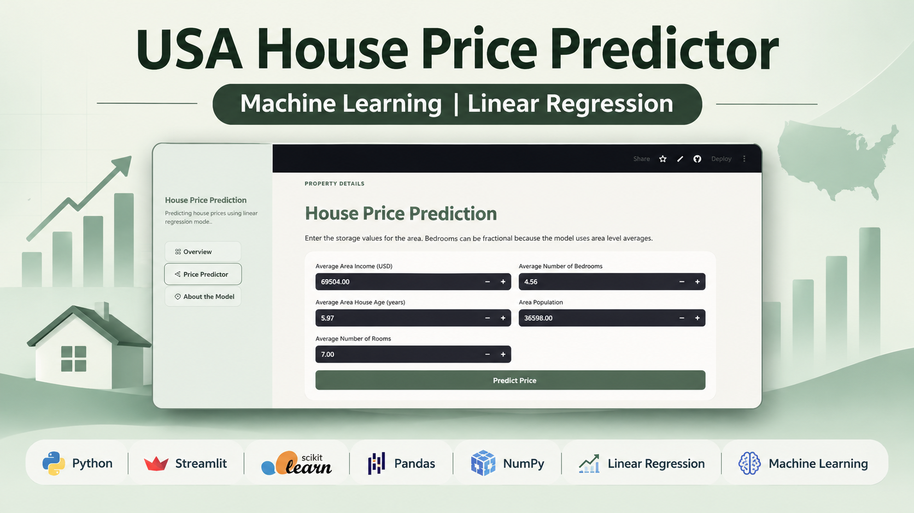
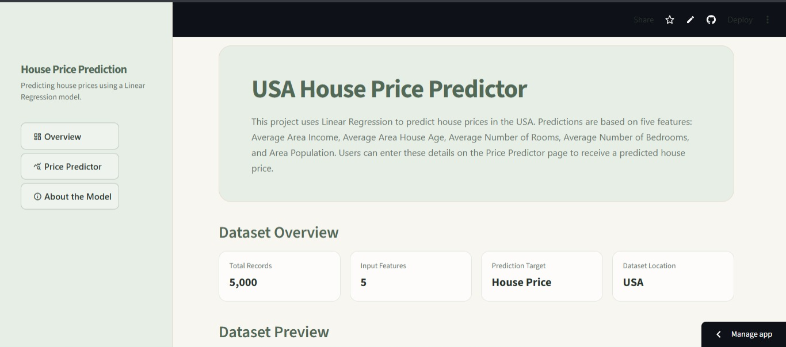
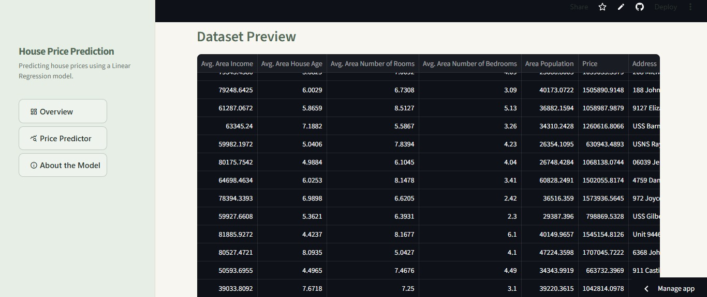
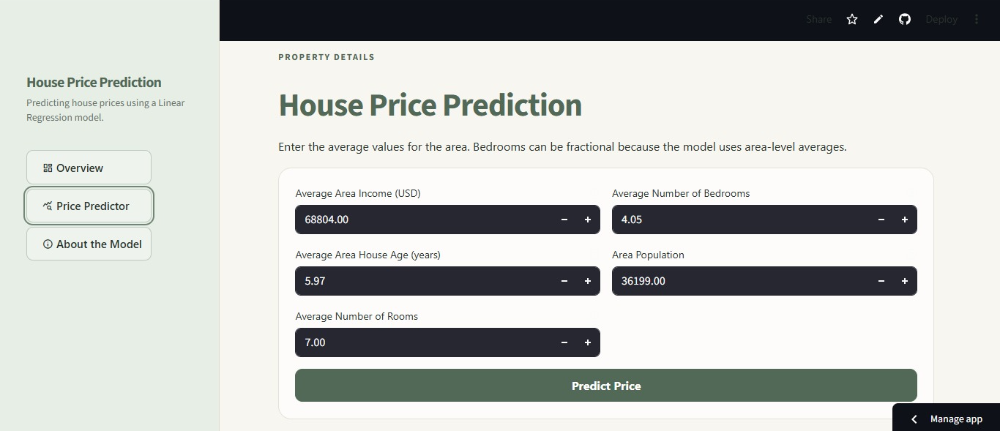
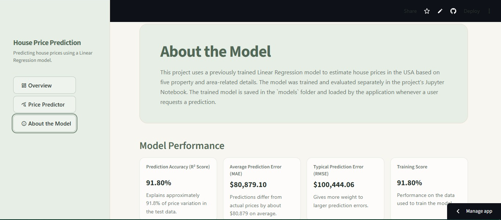
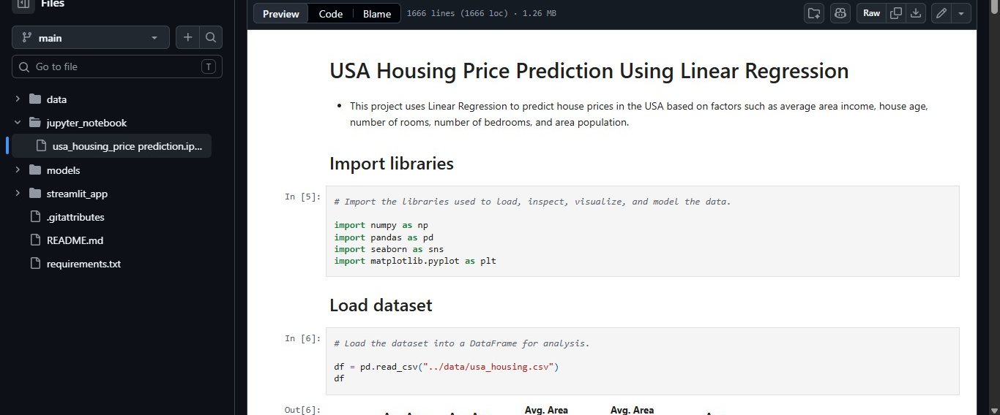
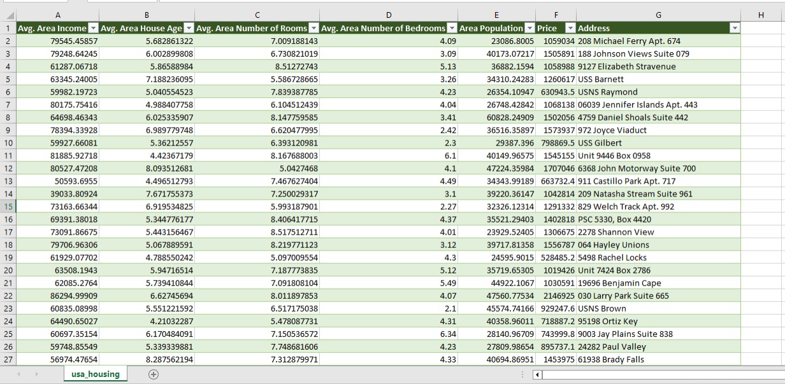

# 📊 USA House Price Prediction

> **Project Status: Completed**




---

## 📈 Project Overview

This project predicts house prices in the USA using Linear Regression. It uses five area and property features to estimate a home's price. The model achieved a test R² score of 91.80%, with an average absolute prediction error of about $80,879.

- It includes:

    - Jupyter Notebook for data analysis and model building
    - Streamlit app for exploring the dataset, estimating a house price, and viewing model performance

- Model Inputs
    - Avg. Area Income
    - Avg. Area House Age
    - Avg. Area Number of Rooms
    - Avg. Area Number of Bedrooms
    - Area Population

---

## 📈 View Project

### 🔹 **Live Interactive App**

- Enter the area details on the Price Predictor page, click **Predict Price**, and view the estimated house price.

- **Link:** [usa-house-price-predictor-streamlit-app](https://usa-house-price-predictor.streamlit.app/).

- **App Preview**









### 🔹 **Jupyter Notebook**

- Follow the complete process from loading and exploring the data to training and evaluating the model.

- **Link:** [usa-house-price-prediction-jupyter-notebook](https://github.com/Chauhanekta21/usa-house-price-prediction/blob/main/jupyter_notebook/usa_housing_price%20prediction.ipynb)

- **Jupyter Notebook Preview**




---

## 📈 Project Workflow

```
USA Housing Dataset
        ↓
Data Loading and Inspection
        ↓
Exploratory Data Analysis (EDA)
        ↓
Data Quality Assessment
        ↓
Feature Selection and Target Separation
        ↓
Training and Testing Data Split
        ↓
Linear Regression Model Training
        ↓
Model Evaluation and Residual Analysis
        ↓
Model Serialization using Joblib
        ↓
Streamlit Application Integration
        ↓
House Price Prediction
```

---

## 📈 Dataset Information

- The dataset contains:

    - 5,000 records
    - 5 input features
    - Target column: `Price`
    - Dataset location: USA
    - An `Address` column, which is not used as a model input

- **Link:** [usa-housing-dataset](https://github.com/Chauhanekta21/usa-house-price-prediction/blob/main/data/usa_housing.csv)

- **Dataset Preview:**




---

## 📈 Key Steps

### 🔹 Data Import

- Loaded `usa_housing.csv` from the `data` folder into a Pandas DataFrame.

---

### 🔹 Data Inspection

- Used `info()` to review columns, data types, and non-null values.
- Used `describe()` to review summary statistics for numeric columns.
- Checked for duplicate rows; the dataset contains no duplicates.

---

### 🔹 Data Cleaning and Transformation

- No data cleaning or transformation was needed for the notebook workflow.

---

### 🔹 Exploratory Data Analysis

- Used histograms and boxplots to review numeric feature distributions.
- Compared each input feature with house price using scatter plots.
- Reviewed feature correlations and visualized them with a correlation heatmap.

---

### 🔹 Feature Selection

- Used `Avg. Area Income`, `Avg. Area House Age`, `Avg. Area Number of Rooms`, `Avg. Area Number of Bedrooms`, and `Area Population` as model inputs.
- Excluded `Address` from the model features and used `Price` as the target.

---

### 🔹 Train-Test Split

- Split the data into 80% training data and 20% testing data, using `random_state=42`.

    - **X:** The five input features used to make a prediction.
    - **y:** The target column, `Price`.

---

### 🔹 Model Training

- Created a `LinearRegression` model using scikit-learn.
- Trained the model with the training data.

---

### 🔹 Model Evaluation

- Evaluated the model using R², MAE, and MSE, and reviewed the training and test scores.
- Plotted actual versus predicted prices and reviewed residual plots to examine prediction errors.

- The model scores and errors were:

    - Test R² Score: 91.80% — the model explains about 91.8% of the price variation in the test data.
    - Training R² Score: 91.80% — the model explains about 91.8% of the price variation in the training data.
    - MAE: $80,879.10 — predictions differ from actual prices by about this amount on average.
    - MSE: $10,089,009,300.89 — the average squared difference between predicted and actual prices; it is measured in squared dollars, so larger errors count more.
    - RMSE: $100,444.06 — an error measure in dollars that gives larger prediction errors more weight.

---

### 🔹 Save the Trained Model

- Saved the trained Linear Regression model as `usa_house_price_prediction_model.pkl` in the `models` folder using Joblib.
- The Streamlit app loads the saved model to make predictions without retraining it.

---

## 📈 Tools and Libraries

- Python
- Jupyter Notebook
- Pandas
- NumPy
- Matplotlib
- Seaborn
- Scikit-learn
- Joblib
- Streamlit
- Streamlit Cloud installs the app dependencies from the root `requirements.txt`, including scikit-learn for loading the saved model.

---

## 📈 Repository Structure

```
usa-house-price-prediction/
|-- data/
|   `-- usa_housing.csv
|-- jupyter_notebook/
|   `-- usa_housing_price prediction.ipynb
|-- models/
|   `-- usa_house_price_prediction_model.pkl
|-- streamlit_app/
|   |-- __pycache__/
|   |   `-- app.cpython-314.pyc
|   `-- app.py
|-- .gitattributes
|-- README.md
`-- requirements.txt
```

---

## 📈 Skills Demonstrated

- Data inspection and exploratory data analysis
- Data visualization with Matplotlib and Seaborn
- Correlation analysis
- Feature selection and train-test splitting
- Regression modeling with Linear Regression
- Model performance evaluation
- Model deployment with Streamlit
- Model serialization and reuse with Joblib

---

## 📈 Author

**Ekta Singh Chauhan**

Data Analyst

Focused on building projects in:

- Excel
- SQL
- Python
- Power BI
- Data Analytics
- Machine Learning

---

## 📈 Disclaimer

This project is for educational exploration only. The estimates are based on patterns in this dataset and should not be used as financial advice or as a substitute for a professional property appraisal.
